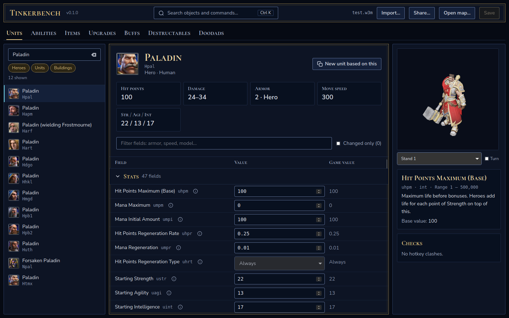

# Tinkerbench

Open-source tools for Warcraft III: Reforged map creation.

> **Status: preview.** Tinkerbench 0.3.0 is the first public release, a preview before 1.0.
> Work on copies of your maps and keep backups.

Read the **[Tinkerbench field guide](https://tinkerbench-docs.vercel.app)** for installation,
first-map tutorials, JASS/Lua API declarations and the object field reference.
The documentation source and local build instructions are in [website/](website/README.md).

## Tools

### Tinkerbench, the map workbench (`object-editor/`)

A companion to the World Editor, built with Rust and Tauri: it replaces the Object Editor and
edits the rest of a map's data around the terrain and triggers. It reads and writes the same
map files as the World Editor.

[](https://tinkerbench-docs.vercel.app/editor/visual-tour/)

<p align="center"><sub><em>Image subject to change.</em></sub></p>

Find an object, understand a field, and see the result in one workbench:

- one search box for names, raw codes and field values;
- fields grouped by topic with full names and a description of what each one does;
- edit in place, with changed fields highlighted and a reset per field;
- ability cards showing icon, tooltip and per-level values wherever an ability is referenced;
- live tooltip preview with color codes;
- a 3D model viewer;
- share codes and bundle files to copy objects between maps, with what they depend on;
- a spell wizard that builds a new spell, its buff and its button, and gives it to units;
- placed units on a map view, with hero items, drops and item tables;
- the map's settings, players, forces and gameplay constants;
- imported models and textures, and in-game dialogs, multiboards, leaderboards and timers;
- CSV and JSON export for spreadsheets, wikis and other tools.

[Take the visual tour](https://tinkerbench-docs.vercel.app/editor/visual-tour/) for a screenshot
walkthrough, from object search to editing ability levels.

It covers units (with heroes and buildings), abilities, items, upgrades, buffs, destructables
and doodads. See
[docs/pet-peeves.md](docs/pet-peeves.md) for the full list of goals.

#### Install

Download **Tinkerbench Setup** from the
[Releases page](https://github.com/gabaudette/wc3-toolkit/releases) and run it. It installs
Tinkerbench for your user only, installs what it needs from the system, finds your Warcraft III
install and Maps folder, and opens Tinkerbench straight on your game. Run it again to update or
remove Tinkerbench.

- **Windows 10 or 11:** `Tinkerbench-Setup-<version>-windows-x64.exe`. It is not signed yet,
  so Windows may show "Windows protected your PC": click **More info**, then **Run anyway**.
- **Linux:** `Tinkerbench-Setup-<version>-linux-x64`. Allow it to run first (the file's
  Properties, or `chmod +x`).
- The `.deb` and `.AppImage` packages are there too; they install only Tinkerbench, so point
  it at your Warcraft III folder on first start.

#### Run from source

You need [Bun](https://bun.sh) and, on Linux, the WebKitGTK libraries Tauri uses
([Tauri prerequisites](https://v2.tauri.app/start/prerequisites/)):

```bash
cd object-editor/app
bun install
bun run tauri dev
```

### Lua script harness (`wc3map lua`)

Builds a development copy of a map with Lua modules from a folder added to the World Editor's
script, so custom code and the editor never overwrite each other. The copy is named
`<map>_dev.w3m` and shows up as `[DEV] <map name>` in the game. Every module is syntax-checked
as Lua 5.3 before anything is written, and the original map is never modified.
`map/src/` holds example modules. Works on Windows, Linux and macOS.

```bash
cargo run --release -p wc3-map --bin wc3map -- path/to/test.w3m lua ../map/src
```

Modules register code to run at game start with `Dev.OnStart(function() ... end)`.

## Requirements

- A legal copy of Warcraft III: Reforged. The tools read game data from your installation;
  this repository contains no Blizzard files.
- Rust (rustup installs the version pinned in `object-editor/rust-toolchain.toml`), a C/C++
  compiler and CMake (for the bundled CascLib and StormLib).

## Building

```bash
cd object-editor
cargo build
```

To inspect the game data the editor works with, point the `wc3data` tool at your install:

```bash
export WC3_GAME_DIR="/path/to/Warcraft III"
cargo run --release -p wc3-data --bin wc3data -- heroes
cargo run --release -p wc3-data --bin wc3data -- unit Hpal
cargo run --release -p wc3-data --bin wc3data -- --hd icon Hpal paladin.png
```

To inspect or edit a map's units (changes are always saved through a temporary copy):

```bash
cargo run --release -p wc3-map --bin wc3map -- my_map.w3m units
cargo run --release -p wc3-map --bin wc3map -- my_map.w3m unit H000
cargo run --release -p wc3-map --bin wc3map -- my_map.w3m set H000 uhpm 1000 -o my_map_edited.w3m
cargo run --release -p wc3-map --bin wc3map -- my_map.w3m check
```

See [CONTRIBUTING.md](CONTRIBUTING.md) for the checks every change must pass.

## License

GNU General Public License, version 2 or (at your option) any later version
(`GPL-2.0-or-later`), see [LICENSE](LICENSE). Bundled third-party code keeps its own
license; see the notices shipped with the app and setup. CascLib and StormLib remain MIT.

Warcraft and Blizzard Entertainment are trademarks or registered trademarks of Blizzard
Entertainment, Inc. This project is not affiliated with or endorsed by Blizzard Entertainment.
