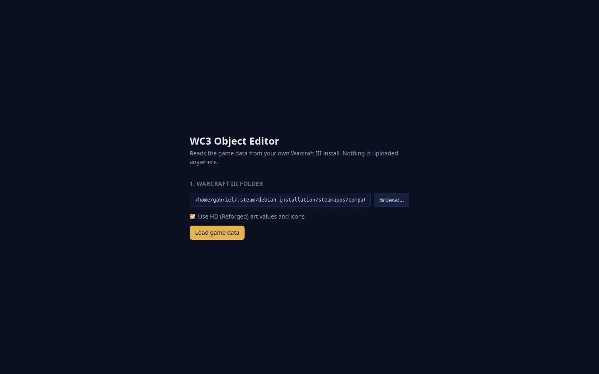
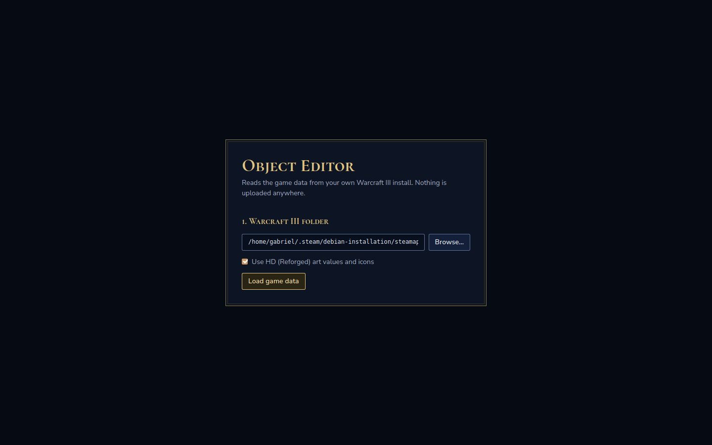
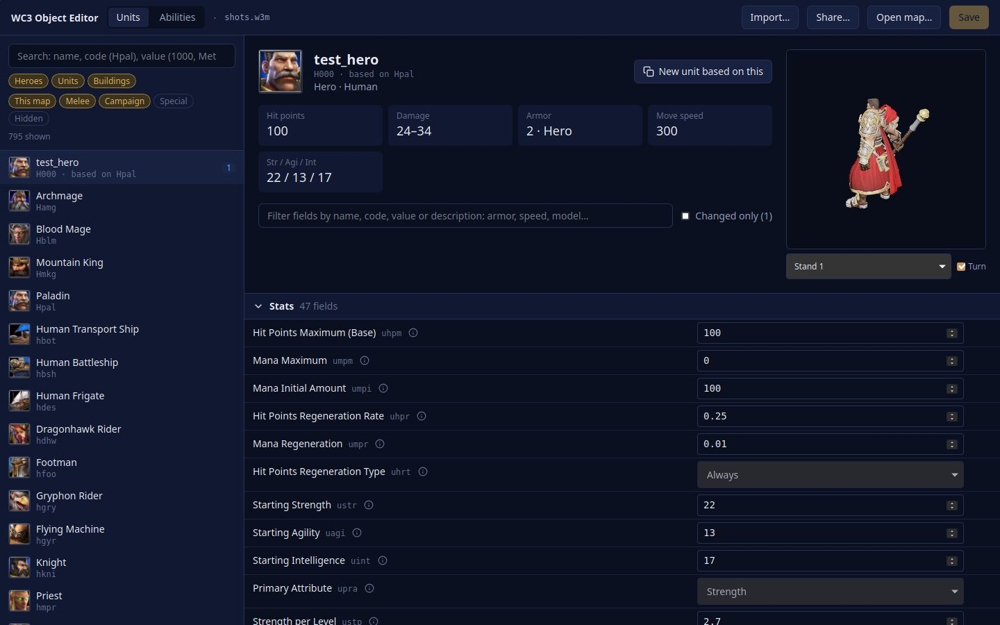
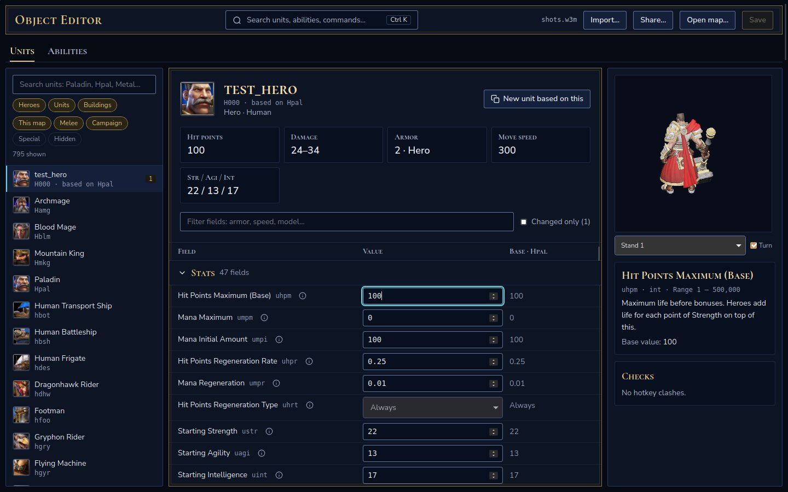
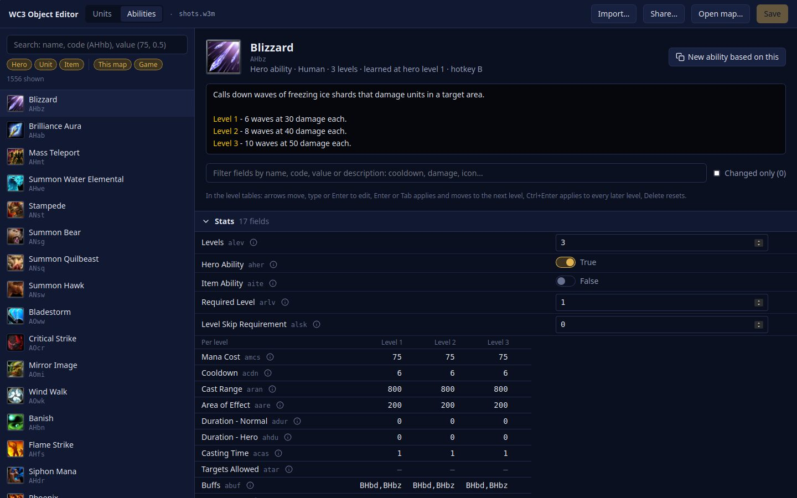
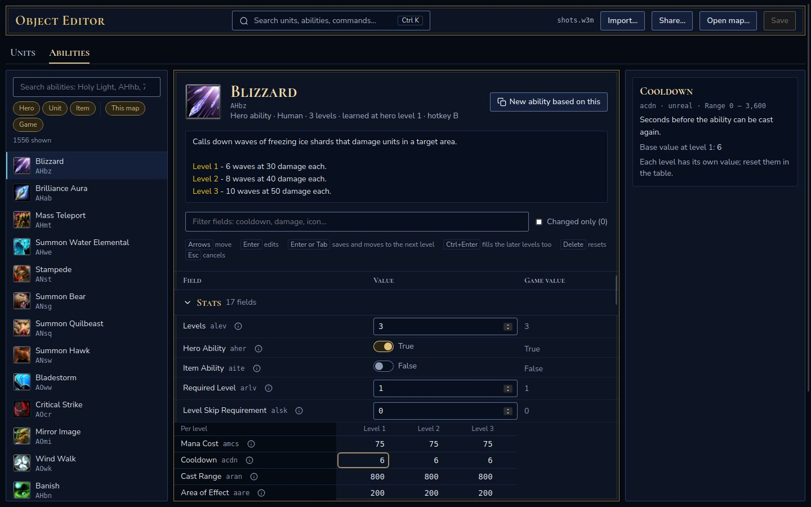
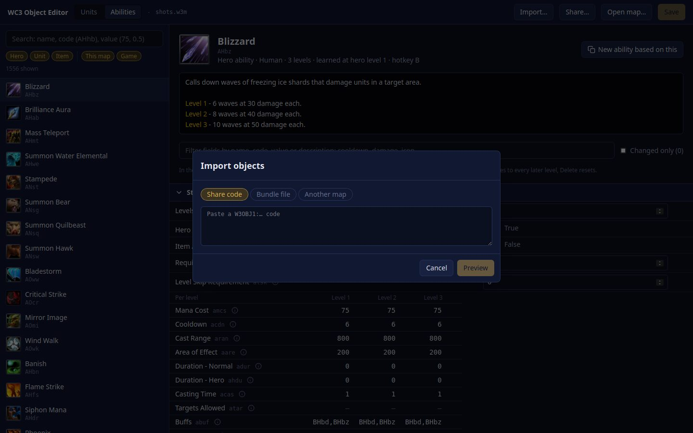
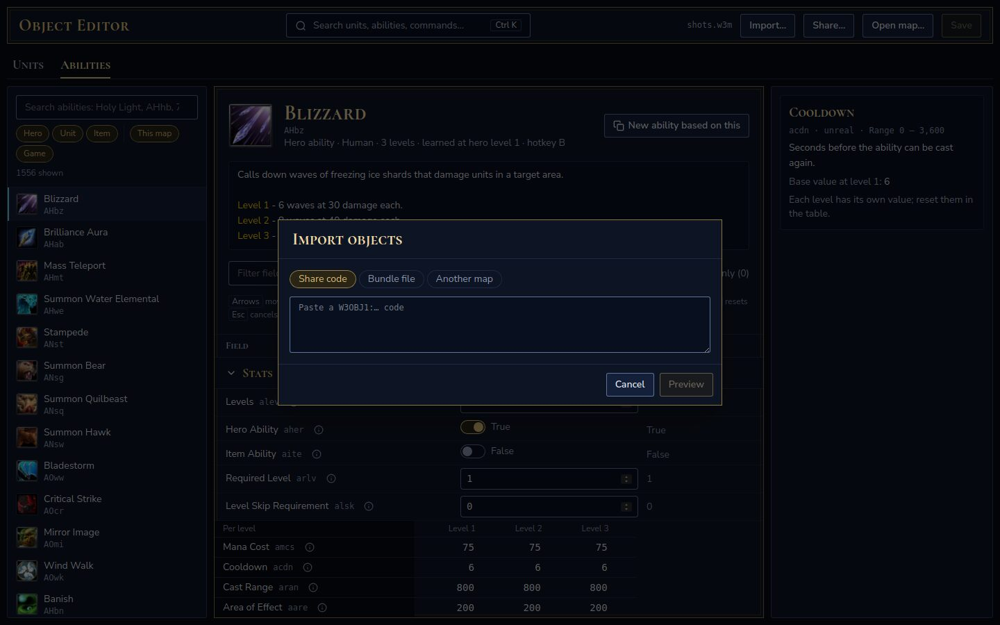
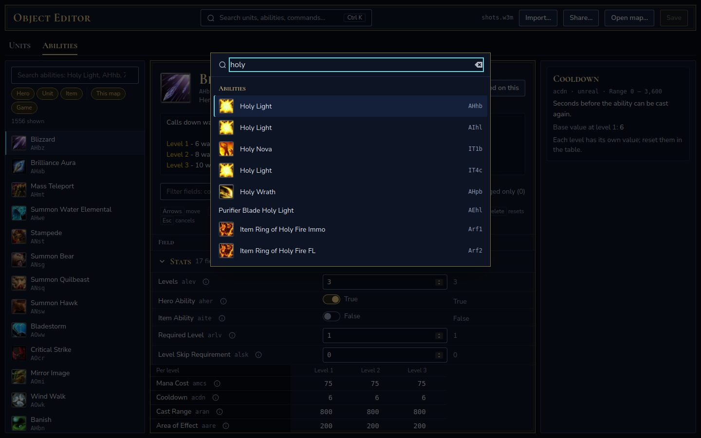

# Editor design: Arcane

The editor looks like Warcraft III Reforged's own menus: deep navy surfaces, fine gold
double-line frames, gold for headings and changes, a teal glow for focus and selection. The
layout is a workbench: object types along the top, the map's objects on the left, the object's
fields in the middle, an inspector on the right, and Ctrl K to jump anywhere.

Decided in AGE-23 after two rounds of mockups (the "WC3 Editor Redesign Directions" canvas):
four first directions (Refined Classic, Workbench, Codex, Balance Sheet), then three takes on
Workbench in Warcraft's UI (Stone & Gold, Leather & Iron, Arcane). Kept from Workbench: the
Ctrl K search, the base value column and the inspector. Dropped: its side rail and its generic
graphite look.

Everything below lives in `object-editor/app/src/styles.css` (tokens) and the components named.

## Before and after

Same map, same objects, 1440 × 900.

| | Before | After |
|---|---|---|
| Setup |  |  |
| Unit page |  |  |
| Ability page |  |  |
| Dialog |  |  |
| Ctrl K | (none) |  |

## Tokens

Tailwind theme colors; use them by name (`bg-surface-1`, `text-gold`), never raw hex.

| Token | Value | Use |
|---|---|---|
| `surface-0` | `#060a13` | Window ground |
| `surface-1` | `#0d1424` | Panels, dialogs |
| `surface-2` | `#142039` | Raised and selected rows, secondary buttons |
| `well` | `#08101f` | Inside of inputs, inspector boxes, stat plates |
| `line` | `#1d2a45` | Dividers and quiet panel edges (decorative only) |
| `line-strong` | `#2c3c60` | Side panel edges (decorative only) |
| `field` | `#5f7299` | Edges of controls: inputs, selects, switches, secondary buttons |
| `frame` / `frame-inner` | `#8a7444` / `#3b3420` | The gold double-line frame |
| `ink` | `#e8ecf5` | Body text |
| `muted` | `#a9b4cc` | Secondary text |
| `faint` | `#8f9bb5` | Codes, counts, hints |
| `gold` / `gold-bright` | `#e2c27d` / `#f3dba6` | Headings, the brand, the primary action, changed values |
| `gold-soft` | `#2a2414` | Primary button and chip fill |
| `changed` / `changed-soft` | `#e2c27d` / `#1c1a12` | Marker and fill of changed fields |
| `glow` | `#6fd3e0` | Keyboard focus, the selected list item, the palette's active result |
| `danger` | `#ff8a8a` | Errors |

Contrast, measured: every text color is at least **5.5:1** on every surface (the weakest is
`faint` on `gold-soft`). `field` is at least **3.36:1** on every surface, so controls stand
out from what is around them (WCAG 1.4.11). Check new pairs before adding them.

## Type

- **Cormorant SC** (600, 700) for display: the title, tabs, page and section headings, dialog
  titles, stat labels, column headers. Small caps; never for body text or values.
- **Nunito Sans** (400, 600, 700) for everything else.
- Monospace for raw codes (`hfoo`, `uhpm`) and paths.

Both fonts are bundled with `@fontsource` packages: the app works offline, and Google Fonts
would also need a CSP change.

## Components and patterns

- **Frame** (`.frame`): gold outer line, a gap of the panel color, a darker inner line. Main
  panels only: the top bar, object pages, dialogs, the setup card. Side panels use `.panel`
  (a quiet `line-strong` edge).
- **Corners** are 3 px everywhere (`rounded-[3px]`), like the game's menus.
- **Buttons** (`Button`): primary is gold text on `gold-soft` with a gold edge, one per view
  (Save, the dialog's main action); secondary is `ink` on `surface-2` with a `field` edge.
- **Inputs** sit in a `well` with a `field` edge; focus turns the edge `glow`.
- **Focus**: every focusable element shows a 2 px `glow` outline on keyboard focus
  (`:focus-visible`).
- **Selection**: the selected list item and the palette's active result get `surface-2` and a
  2 px `glow` bar on the left.
- **Changed fields**: `changed-soft` fill and a 2 px gold bar on the left; section headers
  count them in gold. Gold always means "differs from the base".
- **Field rows** share one grid (`FIELD_ROW_GRID` in `ui.ts`): name, value, base value, reset.
  A header row (`FieldHeader`) names the base: `Base · hfoo` for custom objects, `Game value`
  for the game's own. The base column shows numbers as stored and choices by their label.
- **Inspector** (`Inspector`): the model (units), help for the last focused field (name, code,
  type, range, description, base value, restore) and checks (hotkey clashes). Focusing any
  control in a row, or its info button, inspects that field. Per-level fields show their
  level 1 base and reset in their table.
- **Command palette** (`CommandPalette`, Ctrl K): commands, units and, once something is
  typed, abilities, at most 8 per group. Arrows move, Enter runs, Escape closes.
- **Object types** are tabs in the display font (`aria-current="page"` on the open one). New
  object types (items, upgrades, buffs, doodads, destructables) add a tab, a list and a page on
  these same pieces.

## Accessibility

Audited against WCAG 2.2 AA when the redesign landed. Fixed then:

| Issue | Criterion | Fix |
|---|---|---|
| Control edges at 1.3 to 1.8:1 | 1.4.11 Non-text contrast | `field` edge token for every control |
| Info buttons about 18 px, chips about 20 px | 2.5.8 Target size | At least 24 px, with negative margins so rows keep their height |
| Object tabs were toggle buttons | 4.1.2 Name, role, value | `aria-current="page"` on the open view |
| No main landmark; lists unnamed | 1.3.1 Info and relationships | `<main>` around the content; lists named "Unit list", "Ability list" |
| Unsaved state, "Copied" and "Saved" not announced | 4.1.3 Status messages | `aria-live` on the map state; status region in the share dialog |
| The model turns on its own | 2.2.2 Pause, stop, hide | It stays still under `prefers-reduced-motion` (and "Turn" switches it) |
| Field rows were plain `div`s with focus handling | 1.3.1 | Each row is a `fieldset` named after its field |

Already fine: dialogs and the palette trap focus and close on Escape (react-aria); every input
has a label; icons are decorative (`aria-hidden`) next to visible text; the level tables use a
roving tab index with arrow keys.

Not yet checked: a screen reader pass (Orca on Linux, NVDA on Windows), and zoom to 200%,
where the fixed side columns (18 rem list, 20 rem inspector) leave little room for fields.

## Copy

- Plain, short, direct; many readers are not native English speakers. No idioms.
- Buttons start with a verb and name the result: "Save", "Create share code", "Import 3
  objects", "Discard changes" / "Keep editing".
- Placeholders show real examples: "Search units: Paladin, Hpal, Metal…".
- Empty states say what to do: "Pick a unit on the left", "Select a field to see what it does".
- Errors say what happened and what to do: "Open a map first. Changes are saved into a map."
- Terms, always the same: **unit**, **ability**, **buff**, **field**, **map**, **base value**
  (the value of the object a custom one copies, or the game's), **changed**, **share code**
  (the `W3OBJ1:` text), **bundle file** (`.w3obj`), **imported files** (models, textures and
  icons inside a map).
